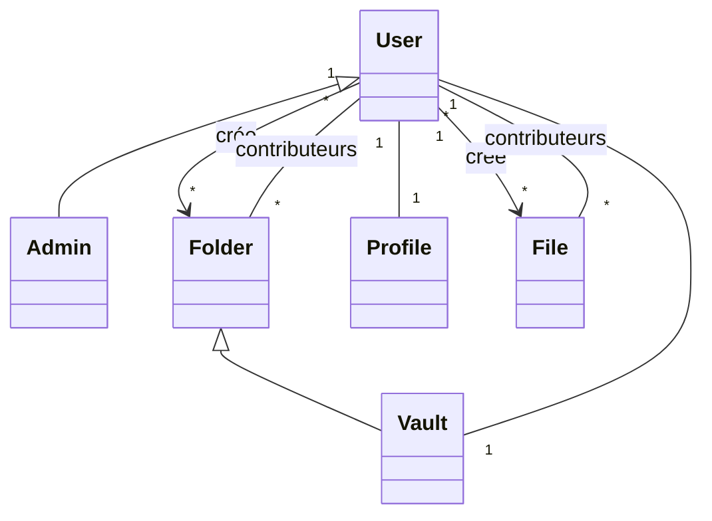

# Projet J2EE

Application **Spring Boot** avec **Thymeleaf**, structurée comme les projets de `dev_JEE`.

## Sommaire

- [Démarrer](#démarrer)
- [Modèle de données](#modèle-de-données)
- [Contrôle d'accès](#contrôle-daccès)
- [Constructeurs de `Folder`](#constructeurs-de-folder)
- [Relations](#relations)

---

## Démarrer

Depuis ce dossier :

```bash
./mvnw spring-boot:run
```

La page d'accueil est disponible sur <http://localhost:8080/>.

---

## Modèle de données

| Entité    | Hérite de | Rôle                                              |
|-----------|-----------|---------------------------------------------------|
| `User`    | n/a       | Utilisateur de l'application                      |
| `Admin`   | `User`    | Utilisateur avec privilèges d'administration      |
| `Profile` | n/a       | Informations de profil d'un utilisateur           |
| `Folder`  | n/a       | Dossier (racine, sous-dossier ou coffre)          |
| `Vault`   | `Folder`  | Coffre personnel d'un utilisateur                 |
| `File`    | n/a       | Fichier contenu dans un dossier                   |



---

## Contrôle d'accès

L'accès d'un utilisateur à un dossier ou un fichier dépend de **deux critères**.

### Côté utilisateur

| Attribut        | Type       | Description                                                                                                   |
|-----------------|------------|---------------------------------------------------------------------------------------------------------------|
| `departements`  | `String[]` | Un utilisateur peut appartenir à **plusieurs départements**. Équivaut à pouvoir consulter les fichiers d'un dossier racine portant le nom du département. |
| `level`         | `int`      | Niveau d'accès, à partir de **0 = niveau le plus élevé**.                                                     |

### Côté dossier / fichier

Chaque `Folder` et chaque `File` possède :

- un **nom de département**
- un **niveau d'accès**

### Droits d'édition

> Créer un dossier ou un fichier **ne donne pas automatiquement** le droit de le modifier aux autres utilisateurs du même niveau.
> Ils doivent être ajoutés explicitement comme **contributeurs**.

---

## Constructeurs de `Folder`

| Constructeur                     | Cas d'usage                                                        |
|----------------------------------|--------------------------------------------------------------------|
| `Folder(Folder parent)`          | Le dossier est inclus dans un autre dossier (sous-dossier)         |
| `Folder(String departementName)` | Dossier **racine** : équivaut à la création d'un département       |
| `Folder(User u)`                 | Utilisé par `Vault` (via `super(u)`) : dossier racine personnel appartenant à l'utilisateur |

> `Vault` hérite de `Folder` : le coffre d'un utilisateur se crée avec `new Vault(user)`, qui appelle `Folder(User u)`.

---

## Relations

### Relations 1-1

| Entité | Relation | Entité    |
|--------|----------|-----------|
| `User` | 1 — 1    | `Profile` |
| `User` | 1 — 1    | `Vault`   |

### Propriété (qui a créé quoi)

| Entité | Relation | Entité   |
|--------|----------|----------|
| `User` | 1 — N    | `Folder` |
| `User` | 1 — N    | `File`   |

### Édition (contributeurs)

| Entité   | Relation | Entité |
|----------|----------|--------|
| `Folder` | N — N    | `User` |
| `File`   | N — N    | `User` |
La page d’accueil est disponible sur <http://localhost:8080/>.


## Securité

### Gestion Connexion

On utilisera un jwt: signé par la variable `SECRET_APPLICATION` dans le `.env`:
-  `flux access token` cookie signé token de 5 minutes 
-  `refresh token` cookie signé d'une semaine pour regénérer le token de 5 minutes

Le nom du patter est le `pattern access token / refresh token`.

### Encryptage de mot de passe

Comme demandé on ajoutera dans la classe `User` associé à la table `User` le paramètre `salt`.

On hashera le mdp avec du sha256(`mot de passe` + `salt`)
