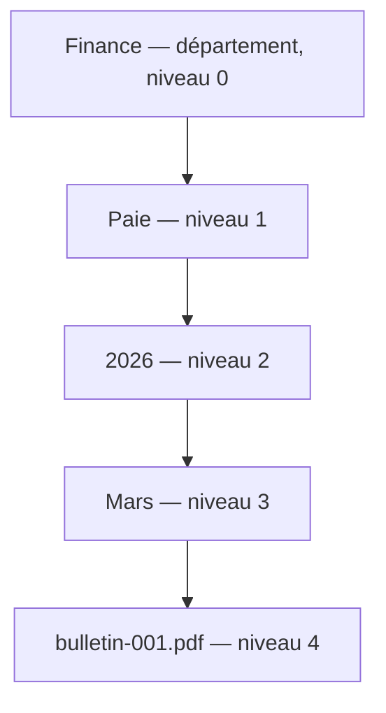

# Projet J2EE

Application **Spring Boot** avec **Thymeleaf**, structurée comme les projets de `dev_JEE`.

## Sommaire

- [Démarrer](#démarrer)
- [Modèle de données](#modèle-de-données)
- [Contrôle d'accès](#contrôle-daccès)
- [Constructeurs de `Folder`](#constructeurs-de-folder)
- [Relations](#relations)

---

## Démarrer

Prérequis : Java 17 ou supérieur, Node.js 22.12 ou supérieur et npm 10 ou supérieur.

Lancer le backend depuis la racine du projet :

```bash
./mvnw spring-boot:run -Dspring-boot.run.profiles=h2
```

Profil PostgreSQL local :

```bash
docker compose -f docker-compose.postgres.yml up -d postgres
POSTGRES_URL=jdbc:postgresql://localhost:5433/projetj2e \
./mvnw spring-boot:run -Dspring-boot.run.profiles=postgres
```

Les migrations Flyway sont dans `src/main/resources/db/migration`.

Validation backend des deux bases :

```bash
./mvnw test -Dspring.profiles.active=h2
POSTGRES_URL=jdbc:postgresql://localhost:5433/projetj2e \
POSTGRES_USER=projetj2e POSTGRES_PASSWORD=projetj2e \
./mvnw test -Dspring.profiles.active=postgres
```

Dans un second terminal, lancer le frontend :

```bash
cd frontend
npm ci
npm run dev
```

## Contrats d'API

Les contrats HTTP versionnés sont définis dans [openapi.yaml](./openapi.yaml).
Ils décrivent les DTO, les paramètres de pagination, les filtres, les statuts
HTTP et les erreurs JSON communes. Les routes REST sont préfixées par `/api`;
les données sont isolées à l'entreprise de la session courante.

Utiliser `frontend/src/lib/api.ts` pour les appels React et `frontend/src/types/api.ts` pour les DTO. `ApiError` expose le statut HTTP, le code et les erreurs par champ. Les listes API utilisent des indices de page à partir de zéro.

- **http://localhost:8080/dashboard** affiche les dossiers et fichiers accessibles au compte connecté. Pour voir un dossier, utiliser un compte administrateur d'entreprise ou un compte membre avec une adhésion au département concerné.
- **http://localhost:5173/** ouvre l'aperçu Vite autonome avec des données simulées, dont l'éditeur et les favoris de démonstration.

---

## Modèle de données


---

## Relations
| Type | Relation |
|------|----------|
| **1-1** | `User` ↔ `Profile` ; `Department` ↔ `Folder` racine |
| **1-N** | `Folder` → `Node` (enfants) ; `User` → `Node` (propriétaire) ; `Department` → `Membership` |
| **N-N** | `User` ↔ `Department` (via `Membership`, avec attribut `accessLevel`) ; `User` ↔ `Node` (contributeurs) |
 
Entités : `User`, `Profile`, `Department`, `Membership`, `Node` (`Folder`, `File`) → plus de 5.
 
Associer/dissocier graphiquement : ajouter/retirer un utilisateur d'un département (avec niveau), ajouter/retirer un contributeur d'un fichier/dossier, déplacer un nœud dans un dossier.
 
JPA : `Node` en `@Inheritance(strategy = SINGLE_TABLE)` ou `JOINED`. La relation `parent` (`@ManyToOne`) vit dans `Node`, `children` (`@OneToMany(mappedBy="parent")`) dans `Folder`.
La page d’accueil est disponible sur <http://localhost:8080/>.


## Regle de permission
Soit `L` = niveau de l'utilisateur dans le département du nœud (via `Membership`), `M` = `minAccessLevel` du nœud.
 
| Situation | Voir | Modifier | Supprimer | Ajouter un contributeur |
|-----------|:----:|:--------:|:---------:|:-----------------------:|
| `L < M` | non (invisible) | non | non | non |
| `L == M`, simple utilisateur | oui | non | non | non |
| `L == M`, **contributeur** | oui | oui | à décider | non |
| `L == M`, **propriétaire** | oui | oui | oui | oui |
| `L > M` | oui | oui | oui | oui |
| `ADMIN` global | tout | tout | tout | tout |
 
Règles d'intégrité à implémenter dans le service :
- Un dossier **sans parent** est créé comme racine : création automatique du `Department` associé (nom = nom du dossier).
- `minAccessLevel` d'un enfant **≥** celui du parent (sinon un fichier serait accessible dans un dossier invisible).
- Un utilisateur ne peut définir un `minAccessLevel` **supérieur à son propre niveau** (à décider).
- Interdire de déplacer un dossier dans l'un de ses descendants (cycle).
- Suppression d'un dossier : cascade sur les enfants.
Toute la logique doit être centralisée dans un `PermissionService` (`canView`, `canEdit`, `canDelete`, `canAddContributor`), idéalement testé unitairement.
 
---
## Securité

### Gestion Connexion

La connexion utilise les sessions HTTP du serveur. Après authentification, l'identifiant
de session est renouvelé et un objet `PublicUser` sans secret est stocké en session.
Les routes privées rechargent l'utilisateur en base pour vérifier son statut actif.

### Encryptage de mot de passe

Les mots de passe sont hachés avec le bean `PasswordEncoder` BCrypt de Spring Security.
Aucun mot de passe en clair ni hash n'est exposé aux templates ou à `PublicUser`.

### Account creation

Each account is created by the user on the registration form, but a boolean will remain false until the admin approves the account. without the approval, login in should be automatically denied.


# Projet J2EE

Application Spring Boot avec Thymeleaf, structurée comme les projets de `dev_JEE`.

## Démarrer

Voir les [commandes de lancement](#démarrer) en début de document.

## Entités

### User

Représente un utilisateur de l'application.

Attributs du diagramme : `id` (`Long`), `firstName` (`String`), `lastName` (`String`), `email` (`String`) et `passwordHash` (`String`).

Un utilisateur possède un profil, peut être propriétaire ou contributeur de plusieurs `Node`, et peut avoir plusieurs `Membership` et `RefreshToken`.

La classe Java `fr.cytech.projetj2e.model.User` est un exemple JPA repris de `compte-client` ; elle utilise `username` et `password` et ne correspond pas encore aux attributs du diagramme.

La section Sécurité prévoit aussi un `salt` et l'approbation des comptes, mais ces éléments ne figurent pas dans le diagramme et ne sont donc pas listés comme attributs confirmés ici.

### Profile

Contient les informations de profil d'un utilisateur. Le diagramme indique les attributs `profilePicture` (`String`) et `bio` (`String`). Chaque `Profile` appartient à exactement un `User`, et chaque `User` possède exactement un `Profile`.

### Admin

Représente un compte administrateur distinct de `User` dans le diagramme. Ses attributs sont `login` (`String`) et `password` (`String`). Le diagramme ne précise aucune association pour cette classe.

### Node

Classe abstraite commune à `Folder` et `File`. Elle regroupe les attributs `id` (`int`), `createdAt` (`Date`), `lastEditedAt` (`Date`), `owner` (`User`), `name` (`String`) et `contributors` (`List<User>`).

Chaque `Node` a un propriétaire. Un utilisateur peut posséder plusieurs nœuds et contribuer à plusieurs nœuds. Les sous-types de `Node` sont contenus dans un `Folder` selon l'association `Children` du diagramme.

### Folder

Représente un dossier dans l'arborescence des fichiers de l'entreprise. Il hérite des attributs de `Node` et possède l'attribut `parentFolder` (`Folder`). Un dossier peut contenir plusieurs `Node` (fichiers ou sous-dossiers). Un dossier racine est associé à un `Department`.

Chaque département constitue un dossier racine, puis les fichiers et sous-dossiers sont organisés par niveaux :

| Niveau | Description |
| --- | --- |
| 0 | Dossier racine correspondant à un département, par exemple `Finance`. |
| 1 | Fichier ou dossier directement contenu dans le département, par exemple `Paie`. |
| 2 et plus | Fichier ou sous-dossier imbriqué dans un élément du niveau précédent. |

La portée d'accès dépend du niveau accordé : le niveau 0 donne accès à tous les départements, le niveau 1 aux fichiers du département concerné et le niveau 2 aux sous-dossiers de niveau 2 de ce département.

Le mode `Contributeur` permet de limiter les droits de contribution à un élément précis, par exemple un seul fichier situé au bout de l'arborescence.

Exemple d'arborescence allant du niveau 0 au niveau 4 :



### File

Représente un fichier stocké dans un dossier. Il hérite des attributs de `Node` et ajoute `originalFileName` (`String`), `contentType` (`String`), `size` (`long`) et `storagePath` (`String`).

### Department

Représente un département. Le diagramme l'associe à exactement un dossier racine (`rootFolder`) et à zéro ou plusieurs `Membership`. Les indications `field:type` et `method(type):type` affichées dans le diagramme sont des placeholders ; aucun attribut concret n'y est spécifié.

### Membership

Associe un `User` à un `Department` et porte son niveau d'accès. Le diagramme indique les attributs `id` (`Long`) et `accessLevel` (`int`). Chaque adhésion concerne un utilisateur et un département ; chacun d'eux peut avoir plusieurs adhésions.

### RefreshToken

Cette entité est décrite dans le README, mais n'apparaît pas dans le diagramme UML. Elle représente un jeton de renouvellement associé à un utilisateur. Les champs actuellement documentés sont `id` (`UUID`), `user_id` (`UUID`), `token_hash` (`String`), `created_at`, `expires_at` et `revoked_at` (`DateTime`). Un utilisateur peut posséder plusieurs jetons. Le type `UUID` de `user_id` diverge du type `Long` de `User.id` dans le diagramme et reste à harmoniser.


## Frontend React et shadcn/ui

L’interface principale est composée dans `frontend/src/App.tsx` et `frontend/src/components/workspace/`. Elle utilise les composants shadcn/ui `Resizable`, `Pagination`, `Avatar`, `Button`, `Input`, `Textarea`, `Badge` et `Sonner`. Le header réutilise `SiteMenu`, construit avec `NavigationMenu`.

Sur le dashboard, l'explorateur charge les racines, les enfants par pages de six et les métadonnées avec le fil d'Ariane. Selon les droits renvoyés par le serveur, il permet de créer, renommer, déplacer ou supprimer un dossier. Ouvrir un dossier accessible en écriture pour importer un fichier par sélection ou glisser-déposer. La progression s'affiche pendant l'envoi.

Sélectionner un fichier pour consulter ses détails et son aperçu. Les textes, images matricielles et PDF s'affichent dans le panneau. Le bouton **Télécharger** permet de récupérer le fichier dans son format d'origine.

Avec le droit de modification, **Modifier le texte** permet d'enregistrer (`Ctrl+S` ou `Cmd+S`) ou d'annuler le brouillon. En cas de conflit, **Recharger la version récente** permet de comparer le texte du serveur avec le brouillon avant de réessayer. Les fichiers binaires peuvent être remplacés. Le déplacement et la suppression dépendent du droit de suppression.

L'aperçu Vite utilise les fichiers d'exemple de `frontend/src/data/workspace.ts` pour la recherche, les favoris et l'édition de texte. Les brouillons survivent au changement de fichier tant que l'explorateur reste ouvert. `Ctrl+S` ou `Cmd+S` enregistre le brouillon en mémoire. Sur mobile, les deux panneaux sont empilés.

### Développement et build

Vite actualise l’interface sur **http://localhost:5173/** lors des modifications React ou CSS.
Les modifications Java nécessitent une relance du backend. Garder les deux terminaux ouverts.

Pour compiler le frontend séparément :

```bash
cd frontend
npm run build
```

Vite génère `app.js` et `app.css` dans `src/main/resources/static/ui/`. Spring Boot sert ces fichiers sur `/ui/` au port 8080. La compilation frontend se lance avec npm.
