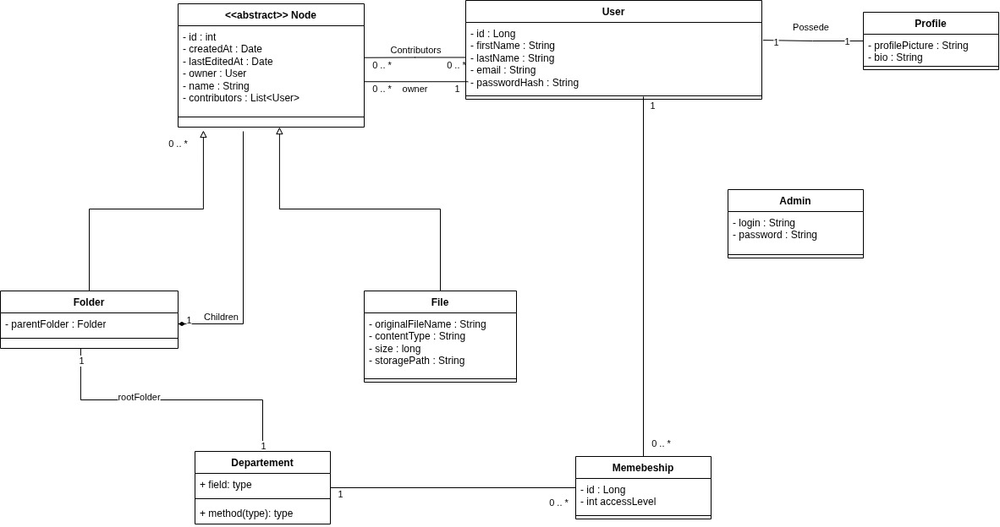

# Projet J2EE

Application **Spring Boot** avec **Thymeleaf**, structurée comme les projets de `dev_JEE`.

## Sommaire

- [Démarrer](#démarrer)
- [Modèle de données](#modèle-de-données)
- [Contrôle d'accès](#contrôle-daccès)
- [Constructeurs de `Folder`](#constructeurs-de-folder)
- [Relations](#relations)

---

## Démarrer

Depuis ce dossier :

```bash
./mvnw spring-boot:run
```

La page d'accueil est disponible sur <http://localhost:8080/>.

---

## Modèle de données


---

## Relations
| Type | Relation |
|------|----------|
| **1-1** | `User` ↔ `Profile` ; `Department` ↔ `Folder` racine |
| **1-N** | `Folder` → `Node` (enfants) ; `User` → `Node` (propriétaire) ; `Department` → `Membership` |
| **N-N** | `User` ↔ `Department` (via `Membership`, avec attribut `accessLevel`) ; `User` ↔ `Node` (contributeurs) |
 
Entités : `User`, `Profile`, `Department`, `Membership`, `Node` (`Folder`, `File`) → plus de 5.
 
Associer/dissocier graphiquement : ajouter/retirer un utilisateur d'un département (avec niveau), ajouter/retirer un contributeur d'un fichier/dossier, déplacer un nœud dans un dossier.
 
JPA : `Node` en `@Inheritance(strategy = SINGLE_TABLE)` ou `JOINED`. La relation `parent` (`@ManyToOne`) vit dans `Node`, `children` (`@OneToMany(mappedBy="parent")`) dans `Folder`.
La page d’accueil est disponible sur <http://localhost:8080/>.


## Regle de permission
Soit `L` = niveau de l'utilisateur dans le département du nœud (via `Membership`), `M` = `minAccessLevel` du nœud.
 
| Situation | Voir | Modifier | Supprimer | Ajouter un contributeur |
|-----------|:----:|:--------:|:---------:|:-----------------------:|
| `L < M` | non (invisible) | non | non | non |
| `L == M`, simple utilisateur | oui | non | non | non |
| `L == M`, **contributeur** | oui | oui | à décider | non |
| `L == M`, **propriétaire** | oui | oui | oui | oui |
| `L > M` | oui | oui | oui | oui |
| `ADMIN` global | tout | tout | tout | tout |
 
Règles d'intégrité à implémenter dans le service :
- Un dossier **sans parent** est créé comme racine : création automatique du `Department` associé (nom = nom du dossier).
- `minAccessLevel` d'un enfant **≥** celui du parent (sinon un fichier serait accessible dans un dossier invisible).
- Un utilisateur ne peut définir un `minAccessLevel` **supérieur à son propre niveau** (à décider).
- Interdire de déplacer un dossier dans l'un de ses descendants (cycle).
- Suppression d'un dossier : cascade sur les enfants.
Toute la logique doit être centralisée dans un `PermissionService` (`canView`, `canEdit`, `canDelete`, `canAddContributor`), idéalement testé unitairement.
 
---
## Securité

### Gestion Connexion

On utilisera un jwt: signé par la variable `SECRET_APPLICATION` dans le `.env`:
-  `flux access token` cookie signé token de 5 minutes 
-  `refresh token` cookie signé d'une semaine pour regénérer le token de 5 minutes

Le nom du patter est le `pattern access token / refresh token`.

### Encryptage de mot de passe

Comme demandé on ajoutera dans la classe `User` associé à la table `User` le paramètre `salt`.

On hashera le mdp avec du sha256(`mot de passe` + `salt`)
